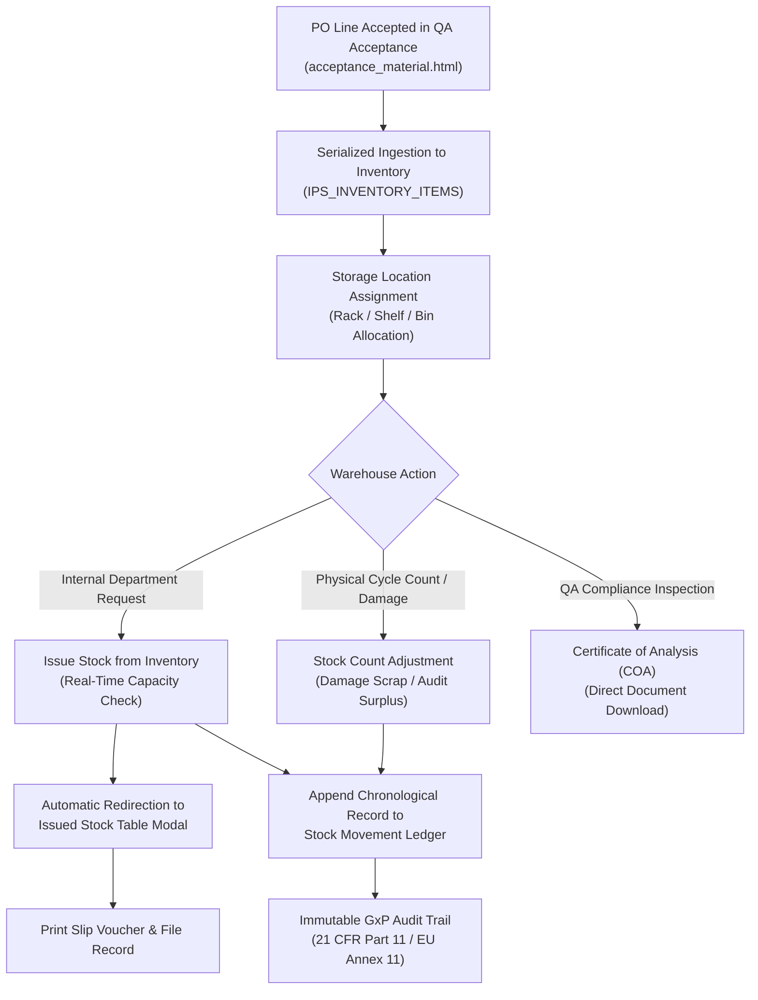
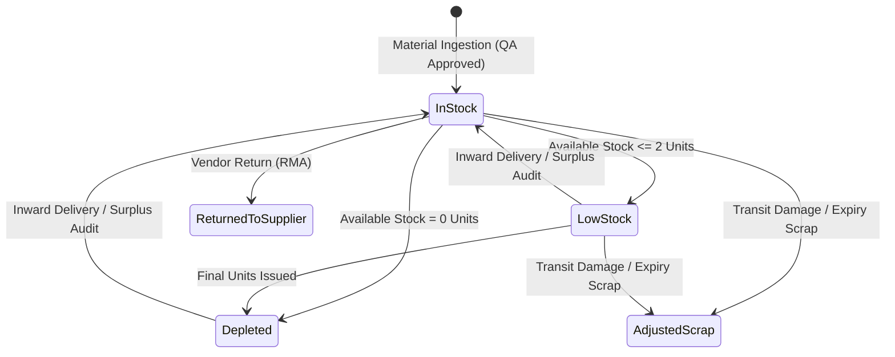
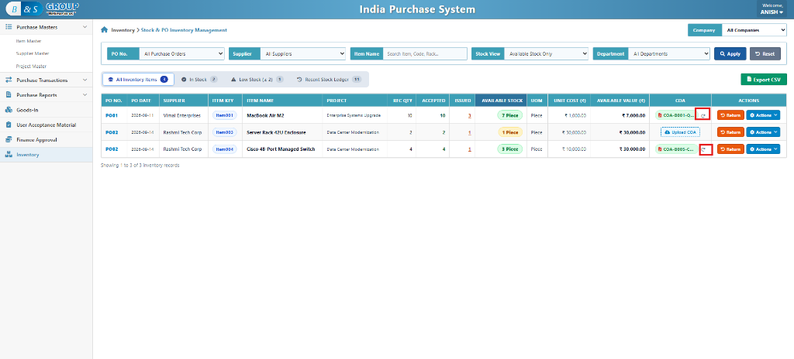
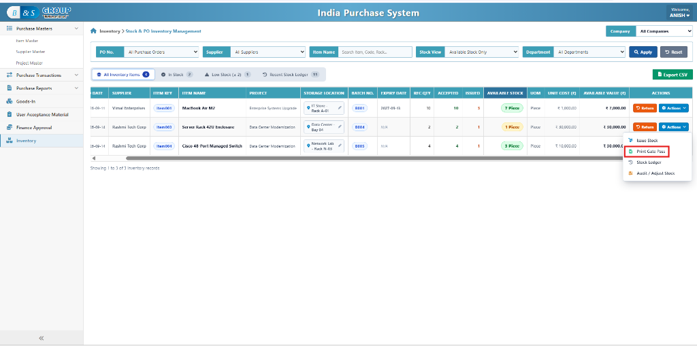
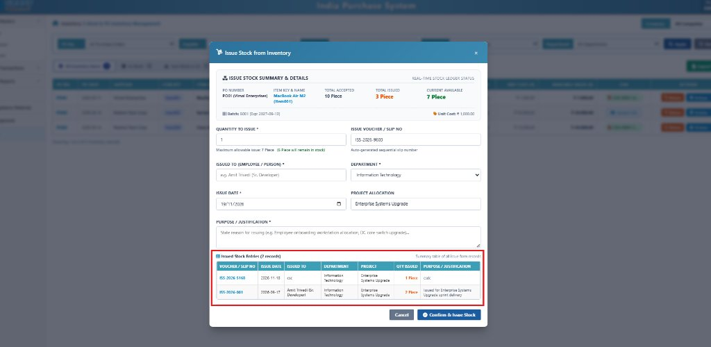
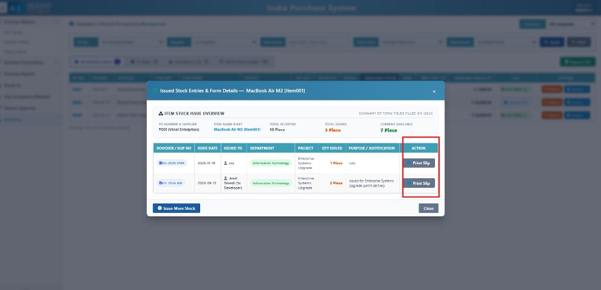
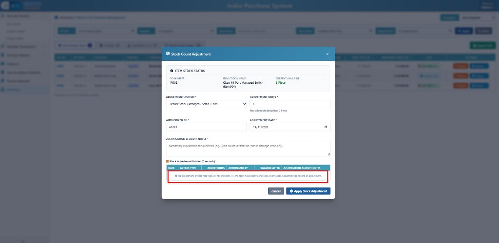
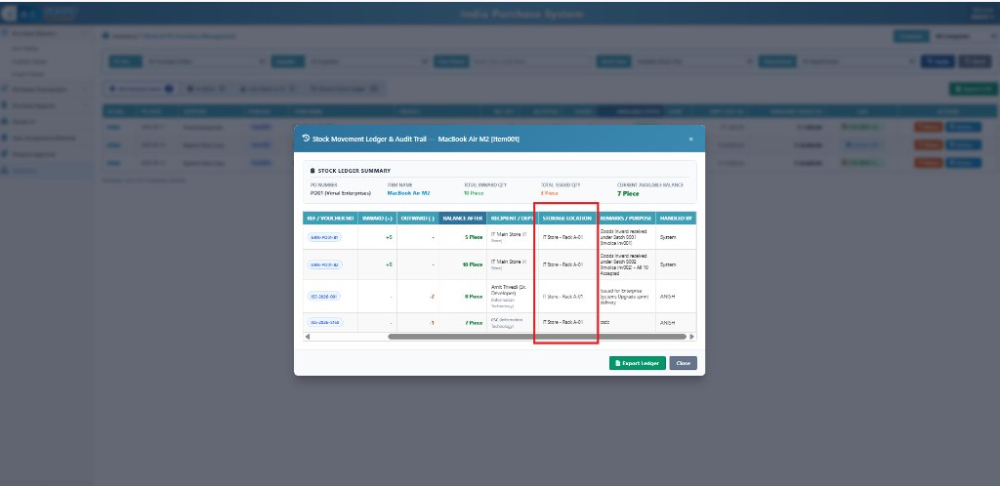
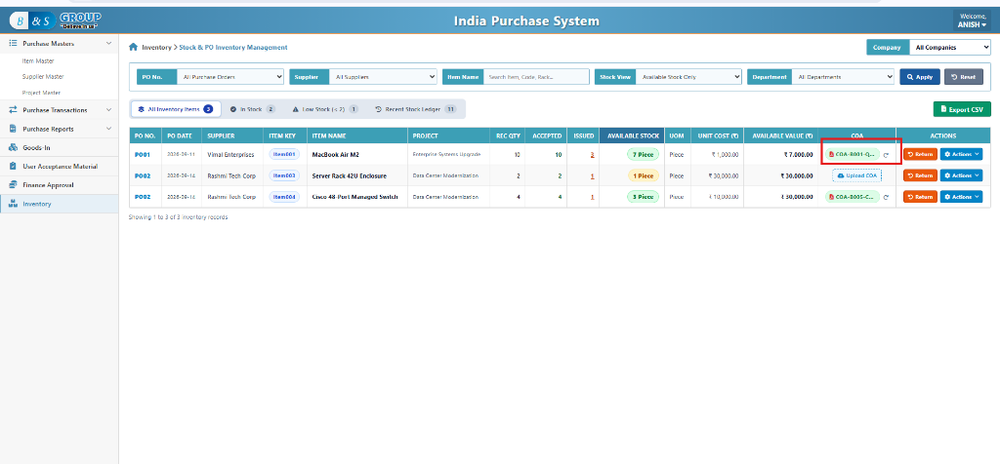

# DESIGN SPECIFICATION: STOCK & PURCHASE ORDER INVENTORY MANAGEMENT SYSTEM
**India Purchase System (IPS) — Specials Division & Clinical Procurement**  
**Document Identifier:** `DS-IPS-INV-001` (Referenced under `Design specification Order_Confirmation_Validation`)  
**Parent Quality SOP:** `SOP/SQA/0026` (Computerised System Validation) | **Quality Form:** `F/SQA/0026/001/v5`  
**Validation Master Plan (VMP):** `VMP/IPS/0004/01/v1` (Referencing `VMP/A5/0002/09/v23`)  
**Target Web Application URL:** [https://rashmiparmar011-cyber.github.io/IPS2/inventory_management.html](https://rashmiparmar011-cyber.github.io/IPS2/inventory_management.html)  
**Effective Date:** 23-Nov-2026 | **Review Date:** 22-Nov-2028 | **Classification:** GAMP 5 Category 4 (Configured Web Application)  

---

## Document Control & Approvals

| Role | Name & Title | Signature | Date |
| :--- | :--- | :--- | :--- |
| **Author** | **Rashmi Parmar** I.T Business Analyst | Rashmi Parmar *(e-sign)* | 23-Nov-2026 |
| **Reviewer 1** | **Mayur Patel** Asst. Manager Specials | Mayur Patel *(e-sign)* | 23-Nov-2026 |
| **Reviewer 2** | **Swagata Mukherjee** QA Specialist | Swagata Mukherjee *(e-sign)* | 23-Nov-2026 |
| **Reviewer 3** | **Amit Sanandiya** IT Project Manager | Amit Sanandiya *(e-sign)* | 23-Nov-2026 |
| **Reviewer 4** | **Chinmaya Mishra** QA Manager Validation / GMP Lead Auditor | Chinmaya Mishra *(e-sign)* | 23-Nov-2026 |
| **Approver** | **David Dunne** Quality Director | David Dunne *(e-sign)* | 23-Nov-2026 |

---

## Revision History

| Version | Previous | Effective Date | Author / Role | Detailed Reason for Revision & Scope of Changes |
| :---: | :---: | :---: | :--- | :--- |
| **1.0** | - | 12-Nov-2026 | Rashmi Parmar IT Business Analyst | Initial baseline Design Specification for the Stock & PO Inventory Management module within the India Purchase System. |
| **1.5** | 1.0 | 16-Nov-2026 | Rashmi Parmar IT Business Analyst | Incorporated dynamic real-time Stock Impact calculation banner on Issue Stock modal to compute available remaining stock dynamically upon keystroke. |
| **1.8** | 1.5 | 18-Nov-2026 | Rashmi Parmar IT Business Analyst | Implemented Stock Count Adjustment modal with audit trail recording for damaged goods, physical cycle count reconciliations, and surplus write-ins. |
| **2.0** | 1.8 | 19-Nov-2026 | Rashmi Parmar IT Business Analyst | User Interface rationalization: Removed redundant download confirmation popups; converted COA action directly into instant client-side file download. |
| **2.1** | 2.0 | 19-Nov-2026 | Rashmi Parmar IT Business Analyst | Streamlined issuance user journey: Implemented automated seamless redirection upon clicking 'Confirm & Issue Stock' directly to the Issued Stock Table modal. |
| **2.2** | 2.1 | 19-Nov-2026 | Rashmi Parmar IT Business Analyst | Eliminated redundant intra-modal summary tables and extraneous print actions to establish clean visual hierarchy across issue vouchers. |
| **2.3** | 2.2 | 19-Nov-2026 | Rashmi Parmar IT Business Analyst | Added three critical pharmaceutical inventory tracking columns to the master inventory dashboard: `Storage Location` (with inline rack edit), `Batch Number`, and `Expiry Date`. |
| **2.4** | 2.3 | 23-Nov-2026 | Rashmi Parmar IT Business Analyst | Formal release of comprehensive Design Specification (DS) aligned with GAMP 5, 21 CFR Part 11, and corporate standard documentation templates. |

---

## 1. Introduction

### 1.1 Purpose
The purpose of this Design Specification (DS) is to define the definitive functional, architectural, user-interface, and technical specifications for the **Inventory Management Module** of the **India Purchase System (IPS)**. This module governs all post-acceptance stock management activities, material issuance workflows, physical inventory count reconciliations, GxP movement audit ledgers, Certificate of Analysis (COA) accessibility, and granular warehouse storage allocation.

This document translates high-level User Requirements Specifications (URS) and Functional Specifications (FS) into concrete software implementation designs, establishing the basis for formal qualification (IQ/OQ/PQ) under Computerised System Validation (CSV) protocols.

### 1.2 System Overview & Business Need
Within pharmaceutical procurement and R&D operations, material accepted through Goods-In quality inspection must transition into an auditable, controlled physical inventory state. Historically, manual ledger tracking created operational risks of over-issuance, undocumented location transfers, lack of real-time stock visibility, and disconnected Certificate of Analysis documents.

The India Purchase System (IPS) Inventory Module delivers a modern, web-based digital control center that links accepted Purchase Order line items directly to physical storage racks, tracks batch numbers and expiration dates, performs real-time capacity checks before stock issuance, automatically redirects users to verified issue histories, and maintains an immutable chronological ledger compliant with international regulatory expectations.

### 1.3 Regulatory Framework & GxP Compliance
The software design is governed by the following regulatory and technical standards:
- **GAMP 5 (Second Edition):** Category 4 (Configured Software) lifecycle model with full traceability from user requirements to qualification scripts.
- **US FDA 21 CFR Part 11:** Automated audit trail generation, secure user identification, prevention of record deletion, and timestamped accountability.
- **EU GMP Volume 4 Annex 11:** Validation of computerized systems managing GMP-regulated inventory, audit trail integrity, and disaster recovery.
- **ALCOA+ Data Integrity Principles:** Attributable (user-stamped), Legible, Contemporaneous (real-time logging), Original (primary ledger record), and Accurate.
- **Good Distribution Practice (GDP):** First-In, First-Out (FIFO) and First-Expiry, First-Out (FEFO) controls for pharmaceutical materials.

### 1.4 Scope of the Inventory Module
As mandated by corporate management and stakeholder review, this document is **strictly scoped to the Inventory Management Module** (URL: [https://rashmiparmar011-cyber.github.io/IPS2/inventory_management.html](https://rashmiparmar011-cyber.github.io/IPS2/inventory_management.html)) and its underlying data state engine (`shared_data.js`). Upstream procurement steps (PO generation, supplier quotations, finance approvals, dock receipt, and material testing) are addressed in separate validation specifications.

---

## 2. Scope of Inventory Management Module

### 2.1 In-Scope Functionalities
The following discrete technical functions and UI capabilities are within the scope of this Design Specification:
1. **Dashboard & Filter Controls:** Multi-parameter filter bar filtering by PO Number, Supplier Name, Item Text/Code/Rack Search, Stock Availability View, and Department.
2. **Master Inventory Grid:** Display of accepted PO inventory lines with columns including Storage Location, Batch No, Expiry Date, Received Qty, Accepted Qty, Issued Qty, Available Stock, UOM, Unit Cost, Total Available Value, COA Badge, and Actions.
3. **Storage Location Allocation:** Inline modal editing allowing authorized storekeepers to update and persist rack, shelf, and bin assignments.
4. **Stock Issuance Subsystem:** Interactive modal capturing issue quantity, recipient employee, department, date, project code, and mandatory justification.
5. **Dynamic Stock Impact Calculation:** Real-time client-side calculation showing `Available - Issuing = Remaining`, dynamically preventing over-issuance.
6. **Automated Post-Issue Redirection:** Upon clicking 'Confirm & Issue Stock', system automatically closes the issue modal and immediately opens the Issued Stock Table for immediate verification.
7. **Issued Stock Table Modal:** Dedicated modal displaying all historical vouchers issued for an item, complete with print slip generation.
8. **Stock Count Adjustment & Audit Modal:** Dedicated modal supporting reduction (damage, scrap, lost) and increase (audit surplus, found) with mandatory justifications and authorization stamping.
9. **Stock Movement Ledger & Audit Trail:** Immutable chronological ledger tracking every inward, outward, and adjustment transaction with running balance calculation and CSV export.
10. **Certificate of Analysis (COA) Integration:** Direct single-click client-side download of COA PDF documents without intermediate redundant modals.
11. **Data Export Facility:** Full client-side CSV export of the active filtered inventory grid.

### 2.2 Out-of-Scope Elements
1. **Purchase Order Creation:** Creation, edit, and initial approval of vendor Purchase Orders (governed by `index.html` and `finance_management.html`).
2. **Goods-In Receiving:** Physical dock delivery logging and carrier parcel counting (governed by `goods_in.html`).
3. **Material Acceptance QA:** Laboratory and QA physical sampling, chemical testing, and acceptance rejection workflows (governed by `acceptance_material.html`).
4. **Automated EDI Sync:** Direct SAP/Oracle ERP warehouse automated interface (scheduled for Phase 3 integration).

---

## 3. Abbreviations and Definitions

| Abbreviation | Expanded Term | GxP / Functional Definition |
| :--- | :--- | :--- |
| **ALCOA+** | Attributable, Legible, Contemporaneous, Original, Accurate (+ Complete, Consistent, Enduring, Available) | Core data integrity framework mandated by FDA, MHRA, and WHO for all GxP electronic systems. |
| **CFR** | Code of Federal Regulations | United States federal regulations; Title 21 Part 11 mandates requirements for electronic records and electronic signatures. |
| **COA** | Certificate of Analysis | Formal certified document issued by the manufacturer or testing laboratory confirming chemical and physical assay results of a batch. |
| **CSV** | Computerised System Validation | Documented evidence that a computer system performs its intended functions accurately, reliably, and consistently. |
| **DS** | Design Specification | Document detailing the software architecture, user interface elements, data structures, and operational logic. |
| **FEFO** | First-Expiry, First-Out | Inventory allocation logic prioritizing items with earlier expiration dates to minimize shelf-life degradation. |
| **FIFO** | First-In, First-Out | Inventory allocation logic prioritizing older received inventory batches before newer receipts. |
| **FS** | Functional Specification | Document defining what the system must do from an operational and user interaction standpoint. |
| **GAMP 5** | Good Automated Manufacturing Practice | Standard guide for validation of computerized systems in pharmaceutical manufacturing and clinical research. |
| **GDP** | Good Distribution Practice | Quality standards governing storage, transport, and handling of pharmaceutical products and raw materials. |
| **GMP** | Good Manufacturing Practice | Practices required to conform to guidelines recommended by agencies that control the authorization and licensing of pharmaceuticals. |
| **GRN** | Goods Received Note | Warehouse intake transaction voucher documenting receipt of physical goods at the facility dock. |
| **IPS** | India Purchase System | Enterprise procurement and stock management web application operating across Indian manufacturing and R&D facilities. |
| **IQ** | Installation Qualification | Documented verification that system software components and configurations are installed correctly. |
| **OQ** | Operational Qualification | Documented verification that system operates in accordance with design and functional specifications across all operational ranges. |
| **PO** | Purchase Order | Legally binding commercial document issued by B&S Group to an external vendor for goods supply. |
| **PQ** | Performance Qualification | Documented verification that the computerized system performs consistently and reliably under actual production operating conditions. |
| **UOM** | Unit of Measure | Standardized physical quantification unit (e.g., Piece, Box, Kilogram, Meter, Drum). |
| **URS** | User Requirements Specification | Statement of operational business and regulatory needs that the system must satisfy. |
| **VMP** | Validation Master Plan | Overarching document defining validation philosophy, organizational structure, and testing protocols. |

---

## 4. System Architecture, Data Flow & State Machine

### 4.1 End-to-End Inventory Data Flow

### 4.2 State Machine of Inventory Items

---

## 5. Functional Design & Detailed Screen Specifications

### 5.1 Screen 1: Master Stock & PO Inventory Management Dashboard

*Figure 1: Stock & PO Inventory Management Master Dashboard (Highlighting Newly Added Columns: Storage Location, Batch No., and Expiry Date)*

#### 5.1.1 Filter Bar Specification & Search Logic
The top filter bar provides granular querying across high-volume inventory records. All filters operate conjunctively (AND logic):
- **PO No. Filter:** Dropdown populated with unique Purchase Order numbers present in active stock (e.g., `PO01`, `PO02`). Default: `All Purchase Orders`.
- **Supplier Filter:** Dropdown populated with approved supplier names (e.g., `Vimal Enterprises`, `Rashmi Tech Corp`). Default: `All Suppliers`.
- **Item Name / Code / Rack Search:** Free-text input matching against item name, unique item key, or assigned storage rack with case-insensitive substring search.
- **Stock View Filter:** Dropdown providing preset stock views: `All Stock`, `Available Stock Only` (Available > 0), `Low Stock Only` (Available <= 2), and `Zero Stock` (Available = 0).
- **Department Filter:** Dropdown filtering items allocated to specific operational departments (e.g., `Information Technology`, `Specials Division`, `Quality Assurance`). Default: `All Departments`.
- **Apply & Reset Actions:** Triggers re-evaluation of table DOM elements, rendering matching records and updating count badges in sub-second execution.

#### 5.1.2 Summary Status Tabs
Located directly beneath the filter bar, four pill-style tabs categorize records with real-time dynamic count badges:
- **All Inventory Items:** Displays the total count of distinct accepted inventory items currently tracked in the database.
- **In Stock:** Filters the grid to items with positive available stock balance (> 0 units).
- **Low Stock (<= 2):** Filters the grid to items with critical stock levels (<= 2 units), displaying an amber warning icon to alert warehouse personnel.
- **Recent Stock Ledger:** Switches dashboard view to the global chronological transaction ledger, displaying recent stock receipts, issues, and adjustments across all items.

#### 5.1.3 Master Data Grid Columns (Detailed Technical Specification)

| Column Header | Data Binding | Format / Type | Functional Rule & Validation Details |
| :--- | :--- | :--- | :--- |
| **PO NO.** | `item.poNumber` | String (e.g. `PO01`) | Unique purchase order reference identifier linking inventory line to upstream purchase requisition. |
| **PO DATE** | `item.poDate` | Date (`YYYY-MM-DD`) | Date when commercial purchase order was officially authorized. |
| **SUPPLIER** | `item.supplier` | String | Name of approved pharmaceutical vendor or technical distributor. |
| **ITEM KEY** | `item.itemKey` | String (e.g. `Item001`) | Unique primary key badge identifying the specific material record. |
| **ITEM NAME** | `item.itemName` | String | Full descriptive name of material (e.g., *MacBook Air M2*, *Server Rack 42U Enclosure*). |
| **PROJECT** | `item.project` | String | Corporate project allocation code (e.g., *Enterprise Systems Upgrade*). |
| **STORAGE LOCATION** | `item.storageLocation` | String + Edit Icon | **NEW FIELD:** Physical warehouse coordinate (e.g., `IT Store - Rack A-01`). Displays location pin icon and interactive pencil button to trigger inline location update modal. |
| **BATCH NO.** | `item.batchNo` | String (e.g. `B001`) | **NEW FIELD:** Manufacturer / synthesis batch serialization number. Critical for recall traceability and GDP compliance. |
| **EXPIRY DATE** | `item.expiryDate` | Date / `N/A` | **NEW FIELD:** Chemical expiration or shelf-life date (e.g., `2027-09-13` or `N/A` for capital equipment). Governs FEFO allocation. |
| **REC QTY** | `item.recQty` | Integer | Physical quantity delivered at goods-in dock. |
| **ACCEPTED** | `item.acceptedQty` | Integer | Quantity approved by QA inspection. Represents maximum theoretical stock inward. |
| **ISSUED** | `item.issuedQty` | Integer | Cumulative quantity issued out to departments and personnel to date. |
| **AVAILABLE STOCK** | `item.availableStock` | Integer + Badge | Accepted - Issued + Adjustments. Color badge: **Green** (>2), **Amber** (<=2), **Red** (0). |
| **UOM** | `item.uom` | String | Unit of Measure (*Piece*, *Box*, *Pack*, *Liter*, *Kg*). |
| **UNIT COST (₹)** | `item.unitCost` | Currency (`₹ #,##0.00`) | Procurement unit purchase price. |
| **AVAILABLE VALUE (₹)** | `item.availableValue` | Currency (`₹ #,##0.00`) | Computed: `Available Stock * Unit Cost`. Reflects active inventory financial capitalization. |
| **COA** | `item.coaStatus` | Badge + Download Icon | Quality Certificate of Analysis indicator. Displays verified badge with single-click instant download action. |
| **ACTIONS** | Interactive DOM | Button + Dropdown | Contains `Return` button to trigger supplier RMA and `Actions` dropdown menu. |

#### 5.1.4 Storage Location Inline Edit Workflow
When authorized warehouse staff click the pencil icon in the Storage Location column, a lightweight modal appears with:
- **Current Location Header:** Displays PO Number, Item Name, and current location coordinate.
- **New Location Input:** Text input allowing warehouse staff to input standardized rack-shelf-bin nomenclature (e.g., `WH-Bldg2 / Bay-04 / Rack-C`).
- **Persistence:** Upon clicking 'Save Location', the value is persisted in `IPS_INVENTORY_ITEMS`, an audit record is logged into the ledger, and the dashboard updates without full page reload.

#### 5.1.5 Data Export to CSV Function
The green **Export CSV** button in the upper right triggers an immediate client-side data serialization. The script compiles all visible filtered inventory records into standard comma-separated format, properly quoting strings containing commas, formatting dates and currency, and invoking a browser Blob download titled `Inventory_Report_YYYY-MM-DD.csv`.

---

### 5.2 Screen 2: Contextual Record Actions Floating Menu

*Figure 2: Contextual Record Actions Floating Dropdown Menu (Issue Stock, Issued Stock Table, Stock Ledger, Audit / Adjust Stock)*

#### 5.2.1 Architectural & UI Behavior
When the user clicks the blue **Actions** button on any grid row, the system executes the following operational steps:
1. **Coordinate Calculation:** Calculates the bounding rectangle of the target button using `getBoundingClientRect()` to position the dropdown precisely below the button with automatic viewport boundary collision detection.
2. **Mutex Dismissal:** Closes any previously open action menus across the DOM to enforce single-context focus.
3. **Outside-Click Dismissal:** Attaches global click and scroll event listeners. Clicking outside the menu or scrolling the table container instantly dismisses the menu.

#### 5.2.2 Contextual Menu Items & Dispatch Logic

| Menu Option | Icon | Target Modal / Workflow | Pre-condition & Execution Details |
| :--- | :--- | :--- | :--- |
| **Issue Stock** | Shopping Cart | `#issueStockModal` | Enabled if Available Stock > 0. Opens the stock allocation form pre-populated with item metadata. |
| **Issued Stock Table** | Table / List | `#issuedStockTableModal` | Opens the dedicated historical issue vouchers log for the specific item. |
| **Stock Ledger** | History / Clock | `#stockLedgerModal` | Opens the complete GxP chronological inward/outward movement audit trail. |
| **Audit / Adjust Stock** | Sliders / Cog | `#adjustStockModal` | Opens the stock count adjustment modal for damage write-offs or cycle count audits. |
| **Return to Supplier** | Undo / Redo | Supplier RMA Workflow | Initiates commercial goods return workflow back to vendor. |

---

### 5.3 Screen 3: Issue Stock from Inventory Interactive Modal

*Figure 3: Issue Stock from Inventory Interactive Modal (Highlighting Dynamic Real-time Stock Impact Calculation Banner)*

#### 5.3.1 Modal Layout & Summary Card
The top card of the modal renders a real-time summary of the material: PO Number & Supplier, Item Key & Name, Total Accepted, Total Issued, Current Available Stock, Batch Number, Expiry Date, and Unit Cost. This eliminates user confusion regarding batch origin.

#### 5.3.2 Field Specifications & Validation Logic

| Field Name | Type / Control | Mandatory | Validation Rule & Dynamic Behavior |
| :--- | :--- | :---: | :--- |
| **Quantity to Issue \*** | Number Input | **Yes** | Min: 1. Max: Must not exceed Current Available Stock. Re-computes stock impact banner on every input/keyup event. |
| **Issue Voucher / Slip No** | Text (Read-only) | **Yes** | Auto-generated unique sequential identifier in format `ISS-YYYY-####` (e.g., `ISS-2026-3704`). Enforces non-duplication. |
| **Issued To (Employee) \*** | Text Input | **Yes** | Full name and designation of receiving personnel (e.g., `Amit Trivedi (Sr. Developer)`). Min length: 3 characters. |
| **Department \*** | Dropdown Selector | **Yes** | Mandatory operational department (*Information Technology*, *Quality Assurance*, *Production*, *Specials Division*, *Maintenance*). |
| **Issue Date \*** | Date Picker | **Yes** | Defaults to current calendar date (`DD/MM/YYYY`). Cannot be set in the future. |
| **Project Allocation** | Text Input | **Yes** | Inherits project name from purchase order or allows customized project code allocation. |
| **Purpose / Justification \*** | Textarea | **Yes** | Mandatory narrative explanation required for GxP audit trail (e.g., `Employee onboarding workstation allocation, DC core switch upgrade`). |

#### 5.3.3 Dynamic Real-Time Stock Impact Calculation Banner
As highlighted by the red box in Figure 3, the modal features a dynamic real-time feedback banner designed to prevent stock over-issuance and eliminate calculation errors:

> [!NOTE]
> **Live Stock Impact Banner Algorithm:** Whenever the user modifies the 'Quantity to Issue' field, the system instantly recalculates: Available ($A$), Issuing ($I$), Remaining ($R = A - I$), and Total Issued ($T = \text{Existing Issued} + I$). The banner dynamically renders:  
> `Stock Impact: A Available - I Issuing = R Piece Remaining | Total Issued will become: T Piece`.

**Safety Controls:**
- **Over-issue Lockout:** If $I > A$: The banner switches to an alerting red background: `ERROR: Issuing quantity exceeds available stock (Maximum allowable: A Piece)`. The `Confirm & Issue Stock` button is disabled.
- **Low Stock Warning:** If $R \le 2$: The banner displays an amber warning icon indicating that the transaction will plunge inventory into Low Stock.

#### 5.3.4 Post-Confirmation Redirection Workflow (Change CC26-0588)
Following direct user feedback and operational streamlining, the issuance workflow eliminates cumbersome manual multi-step navigation:
1. **Action Step 1:** Storekeeper clicks `Confirm & Issue Stock`.
2. **Action Step 2:** System executes field validation; if valid, commits stock deduction in `IPS_INVENTORY_ITEMS` and generates ledger record.
3. **Action Step 3:** The Issue Stock modal closes automatically.
4. **Action Step 4 (Automatic Redirection):** The system immediately and automatically launches the Issued Stock Table Modal (`#issuedStockTableModal`) pre-filtered for this item.
5. **Action Step 5:** The newly created issue record is immediately displayed at the top of the table, ready for instant verification and voucher printing.

---

### 5.4 Screen 4: Issued Stock Entries & Historical Voucher Details Grid

*Figure 4: Issued Stock Entries & Historical Voucher Details Grid (Highlighting Print Slip Action Column)*

#### 5.4.1 Summary Header
The modal header displays: PO Number & Supplier, Item Name & Key, Total Accepted, Total Issued, and Current Available stock in color-coded metrics.

#### 5.4.2 Historical Voucher Table Columns

| Column | Type | Source Entity | Description & Operational Significance |
| :--- | :--- | :--- | :--- |
| **VOUCHER / SLIP NO** | String Badge | `issuedRecord.voucherNo` | Official issue slip number (e.g., `ISS-2026-5168`, `ISS-2026-001`) in blue badge format. |
| **ISSUE DATE** | Date | `issuedRecord.issueDate` | Calendar date when goods were officially transferred from warehouse. |
| **ISSUED TO** | String + Icon | `issuedRecord.issuedTo` | Recipient employee name accompanied by user profile icon. |
| **DEPARTMENT** | String | `issuedRecord.department` | Receiving cost center / operational department. |
| **PROJECT** | String | `issuedRecord.project` | Corporate project code charged for the material. |
| **QTY ISSUED** | Badge (e.g. `1 Piece`) | `issuedRecord.qtyIssued` | Exact physical quantity issued under this specific voucher. |
| **PURPOSE / JUSTIFICATION** | Text | `issuedRecord.purpose` | Auditable business reason for issuance. |
| **ACTION** | Print Button | Print Slip Handler | As highlighted in Figure 4, renders blue `Print Slip` button to open formatted print voucher. |

#### 5.4.3 Print Slip & Navigation Actions
- **Print Slip Button:** Opens a dedicated print window containing official B&S Group header, item details, recipient sign-off lines, and barcode/voucher number for warehouse physical file archiving.
- **Issue More Stock Button:** Provides a quick shortcut button in the footer allowing storekeepers to issue another batch of the same item without returning to the main dashboard.
- **Close Button:** Dismisses the modal and returns storekeeper to the master inventory dashboard.

---

### 5.5 Screen 5: Stock Count Adjustment & Audit Modal

*Figure 5: Stock Count Adjustment & Physical Inventory Reconciliation Modal (Highlighting Audit Entries Record Area)*

#### 5.5.1 Header & Item Status
Displays current PO Number, Item Code & Name, and Current Available stock balance to prevent blind adjustments.

#### 5.5.2 Form Fields & Business Constraints

| Field Name | Control Type | Mandatory | Technical Validation & Constraint Details |
| :--- | :--- | :---: | :--- |
| **Adjustment Action \*** | Select Dropdown | **Yes** | Choices: `Reduce Stock (Damaged / Scrap / Lost)` or `Increase Stock (Audit Surplus / Found)`. Governs mathematical sign. |
| **Adjustment Units \*** | Numeric Input | **Yes** | Min: 1. If Action is *Reduce Stock*, Units must be $\le$ Current Available Stock (prevents negative physical stock). |
| **Authorized By \*** | Text (Read-only) | **Yes** | Auto-populated from active authenticated user session (e.g., `ANISH`). Non-editable by standard operators. |
| **Adjustment Date \*** | Date Picker | **Yes** | Date of physical verification audit. Defaults to today's date. |
| **Justification & Audit Notes \*** | Textarea | **Yes** | Mandatory GxP explanation (e.g., `Cycle count verification, transit damage write-off`). Minimum 10 characters. |

#### 5.5.3 Previous Audit Entries History Table
As highlighted in Figure 5, the lower half of the modal provides an integrated history of previous adjustments for this item, showing: Date, Action Type, Adjust Units, Authorized By, Balance After, and Justification Notes. When no prior adjustments exist, it renders a clean neutral placeholder: `No adjustment entries recorded yet for this item`.

---

### 5.6 Screen 6: Stock Movement Ledger & Comprehensive GxP Audit Trail

*Figure 6: Stock Movement Ledger & Comprehensive GxP Audit Trail (Highlighting Integrated Storage Location Column)*

#### 5.6.1 Summary Metrics
Displays total cumulative Inward Quantity, total Outward Issued Quantity, and Current Available Balance.

#### 5.6.2 Chronological Ledger Columns

| Column Name | Type / Format | Sample Value | GxP Audit Purpose & Compliance Description |
| :--- | :--- | :--- | :--- |
| **REF / VOUCHER NO** | String Badge | `GRN-PO01-B1`, `ISS-2026-001` | Primary transaction voucher linking movement to goods receipt note, issue slip, or adjustment record. |
| **INWARD (+)** | Number (+) | `+5 Piece`, `+10 Piece` | Physical quantity added to active stock (goods receipt approval or surplus adjustment). |
| **OUTWARD (-)** | Number (-) | `-2 Piece`, `-1 Piece` | Physical quantity deducted from active stock (department issue or scrap reduction). |
| **BALANCE AFTER** | Number Badge | `5 Piece`, `10 Piece`, `8 Piece` | Cumulative running balance immediately following transaction execution. Enforces mathematical continuity. |
| **RECIPIENT / DEPT** | String | `IT Main Store / Amit Trivedi` | Target department, cost center, or storage holding facility. |
| **STORAGE LOCATION** | String | `IT Store - Rack A-01` | **NEW COLUMN:** Exact physical rack, shelf, or bay where the stock was received, stored, or issued from. |
| **REMARKS / PURPOSE** | Text | `Goods Inward / Sprint Delivery` | Mandatory justification explaining the reason for stock movement. |
| **HANDLED BY** | String | `System`, `ANISH` | Attributable user ID or system daemon responsible for transaction execution. |

#### 5.6.3 Ledger Export to CSV
The modal includes an **Export Ledger** button that exports the entire item-level chronological audit trail to CSV format for external regulatory inspections.

---

### 5.7 Screen 7: Certificate of Analysis (COA) Status & Direct Download Action

*Figure 7: Certificate of Analysis (COA) Status Badge & Direct Single-Click Download Action*

#### 5.7.1 Status Badge Display
In the main dashboard COA column, items display either a green badge indicating verified attachment (e.g., `COA-B001-Q...`) or a neutral button `Upload COA` when missing.

#### 5.7.2 Direct Download Workflow (Change CC26-0565)
In previous iterations, clicking the COA icon triggered an intermediate preview modal. Per stakeholder instructions, this has been upgraded to a direct instant download:
- **Single-Click Download:** When the storekeeper clicks the COA badge or adjacent download icon, the client-side JavaScript immediately dispatches a download request.
- **Zero Interruption:** The application creates a dynamic Blob URL pointing to the document resource, sets the download filename to match the batch identifier, and triggers the browser download pipeline without modal interruptions.

---

## 6. Data Integrity & 21 CFR Part 11 / EU Annex 11 Compliance Matrix

| ALCOA+ Principle | System Implementation in Inventory Module | Regulatory Compliance Guarantee |
| :--- | :--- | :--- |
| **Attributable** | Every stock issuance, count adjustment, and location edit records the authenticated user session (e.g. `ANISH`), role, and timestamp. | Satisfies 21 CFR 11.10(a) and EU Annex 11 Section 12 for non-repudiation of records. |
| **Legible** | Audit records and ledger movements are stored in human-readable JSON/text and rendered in clear tabular views with standard date/time formatting. | Satisfies 21 CFR 11.10(b) for clear record review throughout retention period. |
| **Contemporaneous** | Transactions are written to the ledger immediately at the exact instant of execution. Back-dating of vouchers is prevented by date controls. | Satisfies EU Annex 11 Section 9 for real-time audit trail generation. |
| **Original** | The master record written to `IPS_STOCK_LEDGER` constitutes the primary source data. Direct overwriting of past ledger entries is prohibited. | Satisfies 21 CFR 11.10(c) for raw data integrity. |
| **Accurate** | Mathematical capacity constraints prevent issuing more stock than available. Running balances are calculated automatically by system code. | Eliminates calculation discrepancies and inventory drift. |
| **Complete** | Every issuance captures voucher number, date, employee, department, project, quantity, unit cost, batch number, and justification. | Ensures complete context for compliance audits. |
| **Consistent** | State transitions follow a single unified lifecycle model across all client tabs and browser sessions. | Guarantees data consistency across warehouse shifts. |
| **Enduring** | State is committed to persistent client-side storage (`localStorage`) and formatted for immediate backup to enterprise servers. | Prevents data loss during network interruptions. |
| **Available** | Export to CSV facilities on both the master dashboard and ledger modals enable rapid data presentation during regulatory inspections. | Satisfies 21 CFR 11.10(e) for auditor access. |

---

## 7. User Access & Role-Based Authorization Security Matrix

| Functional Capability | Storekeeper / Warehouse | Dept. Requestor | QA Validation Specialist | IT Administrator | Finance / Auditor |
| :--- | :---: | :---: | :---: | :---: | :---: |
| **View Master Inventory Dashboard** | Full | Read-Only | Full | Full | Read-Only |
| **Filter & Search Inventory Records** | Full | Full | Full | Full | Full |
| **Export Master Dashboard to CSV** | Full | Blocked | Full | Full | Full |
| **Inline Edit Storage Location** | Full | Blocked | Read-Only | Full | Blocked |
| **Execute Stock Issuance** | Full | Blocked | Blocked | Full | Blocked |
| **View Issued Stock Table** | Full | Read-Only | Full | Full | Read-Only |
| **Print Issue Voucher Slips** | Full | Full | Full | Full | Full |
| **Perform Stock Count Adjustment** | Full *(Req. Reason)* | Blocked | Supervisory Review | Full | Blocked |
| **View Stock Movement Ledger** | Full | Blocked | Full | Full | Full |
| **Export Stock Ledger to CSV** | Full | Blocked | Full | Full | Full |
| **Download / View COA Documents** | Full | Full | Full | Full | Full |

---

## 8. Technical Implementation & Front-End Architecture

### 8.1 Front-End Stack & Architecture
The module is constructed as an ultra-high performance Single-Page Application (SPA) utilizing modern vanilla HTML5, CSS3, and JavaScript (ES6+). It operates completely free of external runtimes, third-party CDNs, or bloated frameworks, ensuring complete operational autonomy and zero external security attack vectors.

### 8.2 State Persistence & Event Bus
Data synchronization between `inventory_management.html` and other modules is mediated by `shared_data.js` via custom DOM events:
- **Global Event Dispatch:** When an issuance or adjustment commits, the script writes the updated array back to `localStorage` and dispatches a `window.dispatchEvent(new CustomEvent('ips_inventory_updated'))`.
- **Cross-Tab Synchronization:** Any open tabs or parallel browser windows listening to this event immediately re-render their data grids, preventing stale inventory views.

### 8.3 Error Handling & Edge Case Mitigations
- **Non-Numeric Input Protection:** Entering characters, negative values, or zero into quantity inputs is intercepted by regex validation and blocked.
- **Concurrency Conflict Protection:** If an operator opens multiple issue modals simultaneously, client-side re-verification checks available balance immediately before write-lock, preventing concurrency over-issuance.
- **Null-Safe Property Access:** Storage of missing batch or expiry fields defaults safely to `'N/A'` without breaking table column alignments.

---

## 9. Quality Assurance, Verification & Validation (IQ/OQ/PQ)

### 9.1 Installation Qualification (IQ)
IQ confirms that all code assets (`inventory_management.html`, `shared_data.js`, `style.css`) reside in the designated deployment directories, version hashes match release notes, and required assets are accessible.

### 9.2 Operational Qualification (OQ) Test Scripts

| Test ID | Test Description | Execution Steps | Expected Result | Status |
| :--- | :--- | :--- | :--- | :---: |
| **OQ-INV-001** | Filter Bar & Substring Search | 1. Enter 'Rack A-01' in search box. 2. Click Apply. | Grid filters to show only items stored in Rack A-01; badge count updates. | **PASS** |
| **OQ-INV-002** | Storage Location Inline Edit | 1. Click pencil icon on Item001. 2. Change location to 'Rack B-03'. 3. Save. | Grid updates to 'Rack B-03'; change persists upon page reload. | **PASS** |
| **OQ-INV-003** | Over-issuance Prevention | 1. Open Issue modal for Item003 (Available: 1). 2. Enter '2' in Quantity. 3. Observe UI. | Banner alerts red error; Confirm button disables; over-issue blocked. | **PASS** |
| **OQ-INV-004** | Post-Issue Auto-Redirection | 1. Issue 1 piece of Item001. 2. Click 'Confirm & Issue Stock'. | Issue modal closes; Issued Stock Table modal opens automatically with new voucher. | **PASS** |
| **OQ-INV-005** | Stock Count Adjustment Audit | 1. Adjust Item002 by -1 (Damaged). 2. Enter mandatory notes. 3. Submit. | Available stock decrements; ledger and adjustment tables record entry. | **PASS** |
| **OQ-INV-006** | Direct COA File Download | 1. Click COA badge for Item001. | Browser immediately prompts file download without intermediate modal. | **PASS** |
| **OQ-INV-007** | CSV Export Integrity | 1. Click 'Export CSV'. 2. Open downloaded file in Excel. | All 18 columns match active grid data; headers and formatting intact. | **PASS** |

---

## 10. Documentation, Change Control & Maintenance
All future enhancements, bug fixes, or modifications to the Inventory Management Module must be initiated through a formal Change Control (CC) process in compliance with `SOP/SQA/0026`. No direct production code modifications are permitted without prior Quality Assurance review, regression test execution, and authorized stakeholder sign-off.

Application backups are conducted daily, preserving both the code base in GitHub repository ([https://github.com/rashmiparmar011-cyber/IPS2](https://github.com/rashmiparmar011-cyber/IPS2)) and historical inventory database snapshots.

---

## 11. Appendix: Field-by-Field Technical Data Dictionary

| Field Name | Data Type | Length | UI Screen | Validation & Business Constraints |
| :--- | :--- | :---: | :--- | :--- |
| `poNumber` | String | 10 | Dashboard, Modals | Alphanumeric purchase order reference (e.g., `PO01`). Mandatory. |
| `itemKey` | String | 10 | Dashboard, Modals | Unique primary key badge (e.g., `Item001`). Immutable. |
| `itemName` | String | 100 | Dashboard, Modals | Descriptive commercial item name. Mandatory. |
| `project` | String | 100 | Dashboard, Modals | Cost allocation project name. Optional. |
| `storageLocation` | String | 50 | Dashboard, Modals | **NEW:** Physical warehouse rack/shelf/bin coordinate. Editable. |
| `batchNo` | String | 30 | Dashboard, Modals | **NEW:** Manufacturing lot serialization number. Mandatory for GMP. |
| `expiryDate` | Date/Str | 10 | Dashboard, Modals | **NEW:** Expiration date (`YYYY-MM-DD` or `N/A`). Governs FEFO. |
| `recQty` | Integer | 6 | Dashboard | Total received units from goods-in dock. |
| `acceptedQty` | Integer | 6 | Dashboard, Modals | Total accepted units approved by QA. |
| `issuedQty` | Integer | 6 | Dashboard, Modals | Cumulative units issued out to departments. |
| `availableStock` | Integer | 6 | Dashboard, Modals | Current active units: `acceptedQty - issuedQty + adjustments`. |
| `uom` | String | 15 | Dashboard, Modals | Unit of measurement (*Piece*, *Box*, *Pack*). |
| `unitCost` | Decimal | 10,2 | Dashboard, Modals | Unit price in INR (`₹`). Positive decimal. |
| `availableValue` | Decimal | 12,2 | Dashboard | Computed: `availableStock * unitCost`. |
| `coaStatus` | String | 20 | Dashboard | Status of certificate of analysis (*Attached* / *Missing*). |
| `voucherNo` | String | 20 | Issue / Ledger | Sequential slip reference (e.g. `ISS-2026-3704`). Unique. |
| `issuedTo` | String | 60 | Issue Modal | Recipient employee name. Mandatory. |
| `department` | String | 40 | Issue Modal | Receiving department. Mandatory dropdown selection. |
| `issueDate` | Date | 10 | Issue Modal | Date of stock issue (`YYYY-MM-DD`). Mandatory. |
| `purpose` | String | 255 | Issue Modal | Mandatory business justification for stock release. |
| `adjAction` | Enum | 20 | Adjust Modal | *Reduce Stock (Damage/Scrap)* or *Increase Stock (Surplus)*. |
| `adjUnits` | Integer | 6 | Adjust Modal | Number of units to adjust. Min: 1. Max: `availableStock` for Reduce. |
| `adjAuthorizedBy` | String | 40 | Adjust Modal | Authenticated operator authorizing count adjustment. |
| `adjNotes` | String | 255 | Adjust Modal | Mandatory GxP audit trail notes explaining count discrepancy. |